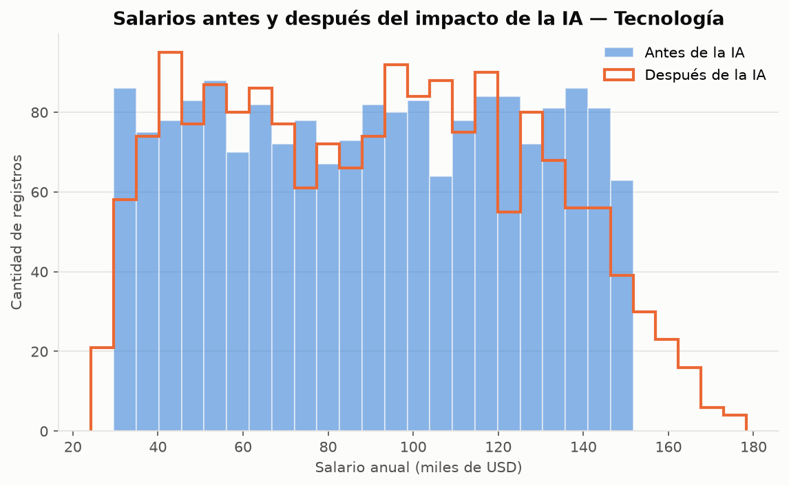
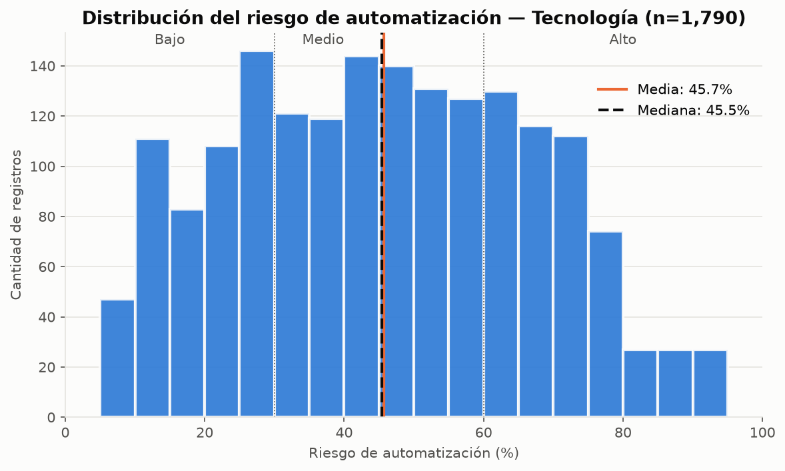
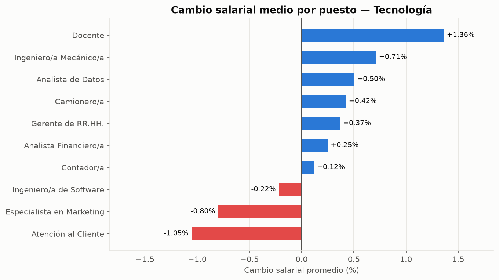
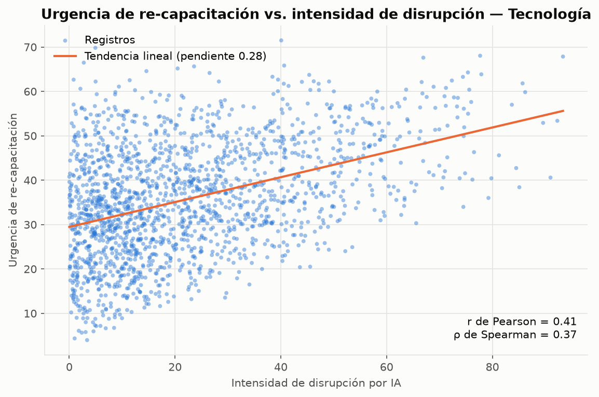

# Informe — Impacto de la IA en el Empleo (2020-2026)

**Sector asignado:** Tecnología · **Grupo 1** · Fundamentos para la Ciencia de Datos

> Todas las cifras de este informe se generan al ejecutar `python main.py`. Las tablas fuente
> están en `outputs/tablas/` y los gráficos en `outputs/figuras/`.

---

## 1. Resumen ejecutivo

- El dataset crudo tenía **15.050 registros**; **1.804 corresponden al sector Tecnología**, con anomalías de
  nulos, formato e inconsistencias lógicas. Después del saneamiento quedaron **1.793 registros válidos**
  (se descartó el 0,6 %: 7 duplicados y 4 contradicciones).
- **247 de los 253 valores faltantes se recuperaron con exactitud** gracias a relaciones matemáticas
  internas del dataset, en vez de imputar promedios. Los 6 restantes son 3 registros sin ningún salario, a los que se les
  imputó la media porque ni la regresión ni el KNN la mejoraron.
- **Salarios:** la media casi no cambia (USD 90.250 → 90.409, +0,18 %), pero la dispersión crece
  (desvío +3,7 %, Gini 0,226 → 0,233). Solo el 40 % de los trabajadores quedó estable: el 31 % ganó
  más de un 5 % y el 30 % perdió más de un 5 %. **Hay una polarización moderada a nivel individual.**
- **Puestos más vulnerables:** Atención al Cliente (59,7 % de riesgo medio), Camionero/a (59,1 %)
  y Especialista en Marketing (46,6 %). **El nivel educativo no explica el riesgo** (r = −0,002).
- **Perfil más resiliente:** Analista de Datos (bajo riesgo, suba salarial y mayor crecimiento de la
  demanda de habilidades), seguido por Ingeniero/a de Software (el riesgo más bajo del sector).
- La urgencia de re-capacitación crece con la intensidad de la disrupción (r = 0,41): es una
  relación positiva pero moderada.

---

## 2. Fase I — Auditoría de calidad

El archivo crudo tiene **15.050 registros** de todos los sectores. La carga se queda con el sector asignado:
se normaliza la escritura de `industria` (hay variantes con espacios y mayúsculas) y se conservan los
**1.804 registros de Tecnología**. Los 751 registros sin industria no se pueden asignar a ningún sector y
quedan fuera del análisis.

### Diccionario de campos

La normalización traduce los nombres de las 20 columnas. En todo el informe se usan los nombres en español:

| Nombre original | Nombre en español | Significado |
|---|---|---|
| `job_id` | `id_registro` | Identificador del registro |
| `job_role` | `puesto` | Puesto de trabajo |
| `industry` | `industria` | Sector |
| `country` | `pais` | País |
| `year` | `anio` | Año |
| `automation_risk_percent` | `riesgo_automatizacion_pct` | Riesgo de automatización (0–100) |
| `ai_replacement_score` | `puntaje_reemplazo_ia` | Puntaje de reemplazo por IA (0–100) |
| `skill_gap_index` | `indice_brecha_habilidades` | Brecha de habilidades |
| `salary_before_usd` | `salario_antes_usd` | Salario previo a la IA (USD) |
| `salary_after_usd` | `salario_despues_usd` | Salario posterior a la IA (USD) |
| `salary_change_percent` | `cambio_salarial_pct` | Cambio salarial (%) |
| `skill_demand_growth_percent` | `crecimiento_demanda_habilidades_pct` | Crecimiento de la demanda de habilidades (%) |
| `remote_feasibility_score` | `factibilidad_remota` | Factibilidad de trabajo remoto |
| `ai_adoption_level` | `nivel_adopcion_ia` | Nivel de adopción de IA |
| `education_requirement_level` | `nivel_educativo_requerido` | Nivel educativo requerido |
| `automation_risk_category` | `categoria_riesgo` | Categoría de riesgo (Bajo, Medio, Alto) |
| `skill_transition_pressure` | `presion_reconversion` | Presión de reconversión |
| `wage_volatility_index` | `indice_volatilidad_salarial` | Volatilidad salarial |
| `reskilling_urgency_score` | `urgencia_recapacitacion` | Urgencia de re-capacitación |
| `ai_disruption_intensity` | `intensidad_disrupcion_ia` | Intensidad de disrupción por IA |

La auditoría solo diagnostica: mide qué está mal y no modifica nada. Se aplica a esos 1.804 registros
crudos (`outputs/tablas/00_auditoria_calidad.csv`):

| Problema | Columna | Registros | Detalle |
|---|---|---:|---|
| Valores nulos | `riesgo_automatizacion_pct` | 79 | 4,4 % de la columna |
| Valores nulos | `salario_antes_usd` | 90 | 5,0 % de la columna |
| Valores nulos | `salario_despues_usd` | 84 | 4,7 % de la columna |
| Escritura inconsistente de la industria | `industria` | 267 | `" Technology "` (96), `technology` (92), `TECHNOLOGY` (79) |
| Año con formato decimal | `anio` | 39 | `2021.0` |
| Monto guardado como texto | `salario_antes_usd` | 161 | `"$61,170.45"` |
| Filas duplicadas exactas | todas | 7 | Comparten incluso `id_registro` |
| Puntaje fuera de la escala 0-100 | `puntaje_reemplazo_ia` | 7 | Máximo 107,6 |
| Salario posterior que no cumple la relación con el % de cambio | `salario_despues_usd` | 5 | Cumplen 1.628 de 1.633 filas evaluadas |
| Salario posterior fuera del límite superior del IQR | `salario_despues_usd` | 1 | `id_registro` 3872; límite 210.405,62 |
| Salario antes = después con cambio % distinto de 0 | `salario_despues_usd` | 4 | `id_registro` 4705, 4710, 6258 y 9069 |

Los 5 salarios que no cumplen la relación son los mismos de las dos últimas filas: 1 salario
atípico y 4 contradicciones. Se superponen, no se suman. El salario atípico (`id_registro` 3872) tiene USD 672.289,50
donde correspondían 67.226,56, es decir, está cargado **exactamente ×10**. El valor centinela `-99999`
(10 veces en el archivo completo) no aparece en Tecnología.

### Relaciones internas descubiertas

Al explorar el dataset verificamos que varias columnas son **derivadas** de otras. Estas identidades
se cumplen en todos los registros completos, salvo en los 5 con errores que se describieron más arriba, y fueron
clave para la limpieza:

| Identidad | Se cumple en | Uso |
|---|---|---|
| `salario_despues = salario_antes × (1 + cambio_salarial_pct / 100)` | 1.628 de 1.633 filas evaluadas (las 5 excepciones son los errores descritos) | Recuperar salarios faltantes y detectar errores |
| `presion_reconversion = (indice_brecha_habilidades + riesgo_automatizacion_pct) / 2` | 1.725 de 1.725 filas | Recuperar el riesgo faltante |
| `intensidad_disrupcion_ia = riesgo_automatizacion_pct × nivel_adopcion_ia / 100` | 1.725 de 1.725 filas | Verificación cruzada |
| `indice_volatilidad_salarial = abs(cambio_salarial_pct)` | 1.800 de 1.804 filas (las 4 excepciones son las contradicciones) | Confirmar contradicciones salariales |
| Categoría de riesgo: Low < 30 ≤ Medium < 60 ≤ High | Todas las filas | Coherencia entre % y categoría |

La relación del riesgo se descubrió con una búsqueda automática (`05_relaciones_exactas.csv`): para cada
columna se ajusta una regresión lineal contra todos los pares de las demás y se marca como fórmula si
el R² llega a 0,9999. Apareció `riesgo_automatizacion_pct = 2 × presion_reconversion − indice_brecha_habilidades`
(R² = 1 en 1.725 filas). Esa búsqueda solo ve combinaciones lineales de dos columnas, así que las
relaciones multiplicativas (salarios, disrupción) y la de valor absoluto (volatilidad) se verificaron aparte.

### Dos tipos de fórmula: explícita y descubierta

Las dos fórmulas que se usan para recuperar nulos se obtienen de forma distinta, y eso explica por qué una se
aplica siempre que se pueda y la otra funciona solo si hay datos de apoyo:

| | Salarios | Riesgo de automatización |
|---|---|---|
| Fórmula | `después = antes × (1 + cambio/100)` | `riesgo = 2 × presión − brecha` |
| Cómo se obtuvo | Es una relación explícita entre los dos salarios y el % de cambio, y se verificó directamente | Se descubrió con la búsqueda automática de pares de columnas (R² ≥ 0,9999) |
| Qué se necesita para aplicarla | Que esté uno de los dos salarios (el % de cambio no tiene nulos) | Que estén presión y brecha |
| Si falta ese dato | No hay de dónde partir y ninguna otra columna ayuda: se imputa la media | Se recupera igual, porque presión y brecha tienen datos completos en esas filas |

En el riesgo, las otras columnas contienen toda la información del objetivo (el valor queda determinado
por dos de ellas), por eso la combinación de columnas llega a un error de 0. En el salario, en cambio,
ninguna otra columna lo determina: el R² de predicción es de apenas −0,011 a 0,046 (tabla 06). La única
información que lo define es el otro salario, y por eso, cuando faltan los dos, la fórmula deja de servir y
solo queda la estadística.

### Cuándo no alcanza la fórmula: comparación de métodos de imputación

Con una fórmula exacta se recupera el valor **verdadero**, mientras que cualquier imputación estima con
error. Lo comprobamos en el riesgo de automatización (`02_comparacion_imputacion.csv`), donde además existe
una regresión razonable:

| Método | Error típico (puntos de riesgo) |
|---|---:|
| Media | 21,3 |
| Regresión lineal (R² de predicción 0,943) | 5,1 |
| Fórmula | 0 |

Quedan **3 registros sin ningún salario**, donde la fórmula no se puede aplicar porque faltan los dos
datos. Para ellos probamos predecir cada salario con las 13 columnas numéricas restantes, sin usar
el otro salario (`06_salarios_sin_el_otro.csv`; separación 80 % entrenamiento / 20 % prueba):

| Salario | R² de ajuste | R² de predicción | Error media | Error regresión | Error KNN |
|---|---:|---:|---:|---:|---:|
| Previo | 0,003 | −0,011 | USD 34.014 | USD 34.138 | USD 37.182 |
| Posterior | 0,060 | 0,046 | USD 35.939 | USD 34.923 | USD 39.302 |

Ninguna otra columna explica el salario: el R² de predicción del salario previo es negativo, la regresión
no mejora a la media y el KNN es peor. Por eso, en esos 3 registros se imputa la **media** del salario previo
y el posterior se calcula con la fórmula.

### Asimetría y valores atípicos

Con la regla del IQR (`03_asimetria_outliers.csv`) casi todas las variables son simétricas. Tienen cola derecha
`indice_volatilidad_salarial` (0,99) y `intensidad_disrupcion_ia` (1,06), lo esperable en variables que
son un valor absoluto y un producto, y `salario_despues_usd` (1,98), por un único valor: el ×10. El IQR
marca ese salario como atípico, y la relación con el % de cambio confirma que es un error de carga. Los demás extremos
(por ejemplo, 12 en `cambio_salarial_pct` y 40 en `intensidad_disrupcion_ia`) no contradicen ninguna relación,
así que se conservan como valores extremos válidos.

---

## 3. Bitácora de saneamiento

Orden de ejecución y justificación técnica (`outputs/tablas/00_bitacora_saneamiento.csv`). Cada módulo
registra sus pasos y `main.py` guarda el resultado al final:

| # | Decisión | Registros | Justificación |
|---|---|---:|---|
| 1 | Incluir las variantes de escritura de `Technology` al cargar | 267 | Espacios y mayúsculas distintas: sin normalizar se habrían perdido esos registros. |
| 2 | Eliminar duplicados exactos | 7 | Comparten incluso `id_registro`: son copias que inflan los conteos y sesgan las medias. |
| 3 | Normalizar `industria` (sin espacios extremos, Formato Título) | 265 | Son la misma categoría escrita de distinta forma. Son 265 y no 267 porque 2 de esos registros eran duplicados que ya se habían eliminado en el paso 2. |
| 4 | Castear salarios a `float` (quitar `$` y `,`) | 161 | Un monto guardado como texto no se puede sumar ni promediar. |
| 5 | Castear año a entero | 39 | El año es discreto; `2021.0` y `2021` deben ser el mismo valor. |
| 6 | Anular el salario posterior atípico (IQR) | 1 | Supera el límite superior del IQR y resulta unas 10 veces el esperado: es un error de carga, no un valor real. Se anula y se recupera con la fórmula, como los demás salarios. |
| 7 | Eliminar contradicciones salariales | 4 | Antes = después pero con cambio de 5 %. No se puede saber qué campo es el correcto, y la volatilidad (= cambio en valor absoluto) tampoco coincide con 5. Es el 0,2 % de los registros. |
| 8 | Acotar `puntaje_reemplazo_ia` a [0, 100] | 7 | Es un puntaje 0-100 que acompaña al riesgo; los excesos son ruido fuera de escala. |
| 9 | Recuperar el salario previo por fórmula | 87 | `antes = después / (1 + cambio/100)`. El cambio % no tiene nulos: el valor recuperado es exacto, no estimado. |
| 10 | Recuperar el salario posterior por fórmula | 81 | `después = antes × (1 + cambio/100)`. También exacto; incluye el salario anulado en el paso 6. |
| 11 | Imputar la media en el salario previo de los registros sin ningún salario | 3 | La fórmula no aplica y ninguna otra columna predice el salario: R² de predicción −0,011, y ni la regresión ni el KNN mejoran a la media. |
| 12 | Recuperar el salario posterior sobre el salario imputado | 3 | `después = antes × (1 + cambio/100)`: mantiene la coherencia con el % de cambio. |
| 13 | Recuperar el riesgo de automatización por fórmula | 79 | `riesgo = 2 × presión − brecha`. Exacto. |
| 14 | Recalcular la categoría de riesgo | 0 | Control de coherencia: no hubo cambios, pero garantiza la regla. |
| 15 | Traducir al español y asignar tipos | 1.793 | Columnas y valores en español; categóricos como `category`; índice reseteado. |

De los 1.804 registros crudos se descartaron 11 (7 duplicados y 4 contradicciones, el 0,6 %), y quedan **1.793 registros válidos**.

**¿Por qué no imputar con la media o la mediana?** Porque el dataset permitía recuperar el valor
**verdadero**: 247 de los 253 valores nulos (el 97,6 %) se calcularon con una fórmula exacta. Imputar la media
habría achicado artificialmente el desvío salarial, que es justamente lo que necesitamos medir para hablar de
polarización. La media se usa solo en los 3 registros sin ningún salario (el 0,17 % de la muestra), donde la comparación
de métodos mostró que ninguna alternativa la mejora.

Al final, `verificar_dataset_limpio()` comprueba que no queden nulos, que los `id_registro` sean únicos y que
todos los salarios sean coherentes. Sobre el dataset limpio, las 5 reglas de negocio dan **0 violaciones**
(`inconsistencias_negocio.csv`).

---

## 4. Fase II — Análisis exploratorio (sector Tecnología, n = 1.793)

### 4.1 Distribución salarial y polarización

| Estadístico | Antes de la IA | Después de la IA | Variación |
|---|---:|---:|---:|
| Media | USD 90.250 | USD 90.409 | +0,18 % |
| Desvío estándar | USD 35.280 | USD 36.581 | **+3,69 %** |
| Mediana | USD 90.450 | USD 90.513 | +0,07 % |
| Coeficiente de variación | 39,1 % | 40,5 % | +3,5 % |
| Percentil 10 | USD 41.370 | USD 41.638 | +0,6 % |
| Percentil 90 | USD 138.974 | USD 140.836 | +1,3 % |
| Ratio P90/P10 | 3,36 | 3,38 | +0,7 % |
| Coeficiente de Gini | 0,226 | 0,233 | **+3,2 %** |

| Resultado individual | Trabajadores | % |
|---|---:|---:|
| Ganancia mayor a +5 % | 549 | 30,6 % |
| Estable (±5 %) | 713 | 39,8 % |
| Pérdida mayor a −5 % | 531 | 29,6 % |

**Interpretación:** en promedio el sector "no se mueve", porque las subas y las bajas se compensan. Pero
esa estabilidad agregada esconde una **polarización moderada**:

- El desvío y el Gini crecen más de un 3 %.
- El percentil 90 sube más que el percentil 10, así que la brecha entre los que más y los que menos ganan se amplía.
- 6 de cada 10 trabajadores tuvieron un cambio salarial mayor al 5 %, con proporciones casi iguales hacia arriba y hacia abajo.

Por cuartil del salario previo, el cambio medio es pequeño en todos los tramos (entre −0,03 % y +0,47 %). Es decir, la
polarización no depende de cuánto ganaba cada persona antes de la IA.

### 4.2 Grado de vulnerabilidad: los 3 roles de mayor riesgo

| Puesto | Riesgo medio | % en categoría "Alto" | Nivel educativo medio |
|---|---:|---:|---:|
| **Atención al Cliente** | 59,7 % | 49,7 % | 3,07 |
| **Camionero/a** | 59,1 % | 46,5 % | 3,10 |
| **Especialista en Marketing** | 46,6 % | 32,6 % | 3,05 |
| _Promedio del sector_ | _45,7 %_ | — | _3,02_ |
| _Ingeniero/a de Software (mínimo)_ | _35,3 %_ | _10,2 %_ | _3,10_ |

**Relación con el nivel educativo:** no existe. La correlación entre nivel educativo y riesgo es nula
(Pearson −0,002; Spearman 0,002), y el riesgo medio por nivel educativo es casi constante (de 44,2 % a 47,0 %).
En los tres puestos de mayor riesgo, los registros se reparten de forma pareja entre los niveles 1 a 5
(entre 17 % y 24 % en cada nivel). En este dataset, **la vulnerabilidad depende de la tarea que realiza el puesto, no de
la credencial educativa**.

### 4.3 Inconsistencias de negocio

Se detectaron y trataron en la limpieza (ver bitácora, pasos 6 a 8 y 14): 1 salario ×10, 4 contradicciones
antes = después y 7 puntajes fuera de escala. Se verificó que, después del tratamiento, ninguna regla de negocio
queda violada.

---

## 5. Fase III — Visualización

### Histograma de riesgo

La distribución es unimodal, centrada en el tramo "Medio", y prácticamente simétrica: la media (45,7 %) y la mediana
(45,5 %) casi coinciden. Por encima del 80 % de riesgo la cantidad de registros cae fuerte. La mayor parte del sector
está en riesgo medio, no extremo.

### Cambio salarial por puesto

Los cambios medios son chicos (entre −1,05 % y +1,36 %). Atención al Cliente, que es el puesto de mayor
riesgo, también es el que más pierde salario. Especialista en Marketing (3º en riesgo) es el segundo que más pierde.
Así, en los puestos más expuestos, riesgo alto y pérdida salarial aparecen juntos.

### Urgencia de re-capacitación vs. intensidad de disrupción

La relación es positiva y moderada (r = 0,41; pendiente 0,28). La nube tiene forma de abanico: con
disrupción baja hay urgencias de todo tipo (de 5 a 70), y con disrupción alta casi no aparecen urgencias bajas.
Una disrupción alta es **suficiente** para que la urgencia sea alta, pero no es **necesaria**. La urgencia
también depende de la brecha de habilidades.

---

## 6. Fase IV — Reflexión crítica

> **Nota para el grupo:** esta sección es un borrador basado en las tablas generadas. Para la defensa oral,
> revísenla y escríbanla con sus propias palabras.

### ¿Qué perfil tecnológico es más resiliente?

Construimos un **índice de resiliencia**: el promedio de los puntajes z de cuatro indicadores. Suman el
cambio salarial y el crecimiento de la demanda de habilidades; restan el riesgo y la urgencia de re-capacitación
(`resiliencia_puestos.csv`).

| Puesto | Riesgo | Cambio salarial | Crec. demanda | Urgencia | Índice |
|---|---:|---:|---:|---:|---:|
| **Analista de Datos** | 37,6 % | +0,50 % | **6,13 %** | 32,6 | **0,97** |
| Ingeniero/a de Software | **35,3 %** | −0,13 % | 5,42 % | **31,5** | 0,69 |
| … | | | | | |
| Atención al Cliente | 59,7 % | −1,05 % | 5,33 % | 41,4 | −1,20 |

El perfil más resiliente es **Analista de Datos**. Es el único que combina un riesgo bajo (2º más bajo del sector),
suba salarial y el mayor crecimiento de demanda de sus habilidades. Ingeniero/a de Software tiene el riesgo
más bajo (solo 10 % de registros en categoría "Alto"), pero su salario medio cae levemente (−0,13 %).

### Tres recomendaciones para un gremio tecnológico (próximos 3 años)

1. **Priorizar la reconversión de Atención al Cliente y Camionero/a.** Tienen ~60 % de riesgo medio,
   casi la mitad de sus registros en categoría "Alto" y la mayor urgencia de re-capacitación (más de 40). Conviene orientar
   los programas hacia las habilidades de los perfiles resilientes (análisis de datos, software).
2. **Negociar formación en habilidades, no solo títulos.** El nivel educativo no protege del
   riesgo (r ≈ 0). Lo que diferencia a los perfiles resilientes es la demanda de sus habilidades,
   así que la capacitación técnica continua debería ser parte de los convenios.
3. **Proteger frente a la volatilidad salarial, no solo frente a la baja del promedio.** El salario medio
   no cambia, pero el 60 % de los trabajadores tuvo variaciones mayores al ±5 % y la desigualdad crece.
   Sugerimos negociar pisos salariales o cláusulas de transición y usar la intensidad de disrupción por puesto
   como alerta temprana de necesidad de re-capacitación.

---

## 7. Limitaciones

- Según el diccionario, los índices y scores son **sintéticos/simulados**. Los resultados sirven para
  ejercitar el método, no para describir el mercado real.
- Dentro de "Tecnología" aparecen puestos como Docente o Camionero/a. Esto es propio de un dataset sintético;
  los interpretamos como roles que trabajan dentro de empresas tecnológicas.
- 751 registros del archivo crudo no tienen industria y quedaron fuera del análisis del sector. No se pudo saber
  a qué sector pertenecían.
- En 3 registros sin ningún salario se imputó la media del salario previo (USD 90.250,49) y el posterior se calculó
  con la fórmula. Son el 0,17 % de la muestra, pero esos dos valores son estimados y no observados.
- El índice de resiliencia da el mismo peso a sus cuatro indicadores. Con otros pesos el orden de los puestos
  intermedios podría cambiar, aunque los extremos (Analista de Datos arriba, Atención al Cliente abajo) son claros.
  
